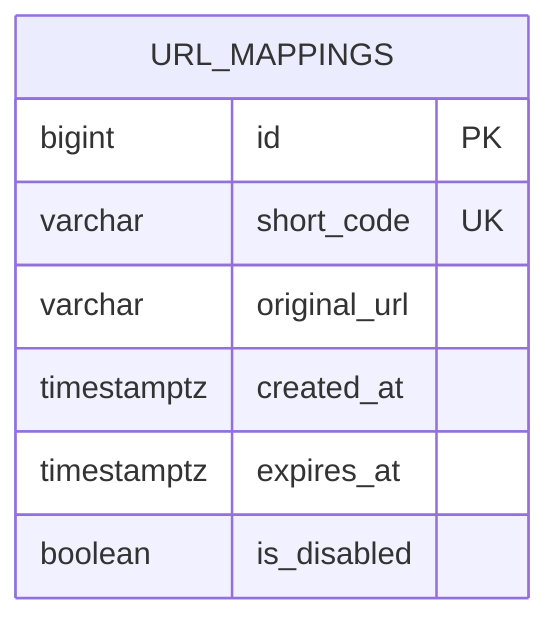

# HelixURL — Domain and Database Design

**Document ID:** HLX-DBD-001  
**Version:** 0.2.0  
**Status:** Approved — M2 Design Baseline  
**Project:** HelixURL  
**Milestone:** M2 — System Design  
**Last Updated:** 2026-11-22

## 1. Purpose

This document defines the initial domain model, relational data model, PostgreSQL schema, constraints, indexes, and persistence considerations for the HelixURL MVP.

The design is based on the approved requirements baseline and the approved modular monolith architecture.

The primary objective is to support reliable URL creation, short-code resolution, optional expiration, and administrative disabling with minimal database complexity.

## 2. Design Principles

The database design follows these principles:

1. Model only data required by the MVP.
2. Separate internal identifiers from public short codes.
3. Enforce critical data integrity constraints in PostgreSQL.
4. Allow different short codes to reference the same destination.
5. Represent expiration as an optional absolute instant.
6. Preserve mapping state when a link expires or is disabled.
7. Avoid unnecessary tables, indexes, and relationships.
8. Manage schema evolution using Flyway migrations.
9. Design for deterministic testing and concurrent requests.
10. Keep persistence concerns separate from domain behaviour.

## 3. Domain Model

### 3.1 Primary Entity: URL Mapping

A URL Mapping represents a persistent association between a unique short code and an original destination URL.

**Attributes:**

| Attribute | Domain Type | Required | Description |
|---|---|---|---|
| id | Long | Yes | Internal persistent identifier |
| shortCode | String | Yes | Unique public short code |
| originalUrl | String | Yes | Original destination URL |
| createdAt | Instant | Yes | Mapping creation instant |
| expiresAt | Instant | No | Optional expiration instant |
| disabled | boolean | Yes | Administrative disabling state |

### 3.2 Domain Invariants

The following invariants must hold:

- Every persisted mapping has an internal identifier.
- Every mapping has a non-empty short code.
- Every short code is unique.
- Every mapping has a non-empty destination URL.
- The destination URL must satisfy approved validation rules.
- A mapping has exactly one creation timestamp.
- An expiration timestamp, when present, must be later than creation.
- An expired mapping is not automatically deleted.
- A disabled mapping cannot be resolved to an eligible redirect.
- Multiple mappings may reference the same original URL.

### 3.3 Redirect Eligibility

A mapping is eligible for redirection if:

`!disabled && (expiresAt == null || now.isBefore(expiresAt))`

The mapping is expired when:

`expiresAt != null && !now.isBefore(expiresAt)`

At the exact expiration instant, the mapping is expired.

### 3.4 Mapping Lifecycle

The MVP does not require a dedicated lifecycle-status column.

The mapping's effective state is derived from:

- `is_disabled`
- `expires_at`
- The current instant

A mapping can be:

- Active and eligible.
- Expired.
- Administratively disabled.
- Both expired and disabled.

The public API returns HTTP 404 for unavailable mappings regardless of the internal reason.

## 4. Entity Relationship Model

The MVP contains one persistent entity:

`url_mappings`

There are no foreign-key relationships in the initial schema.

User accounts, analytics events, QR codes, custom domains, and click-tracking records are outside the MVP scope.

### 4.1 ERD



## 5. Logical Data Dictionary

| Column | PostgreSQL Type | Nullable | Default | Constraints |
|---|---|---|---|---|
| id | BIGINT | No | Identity | Primary key |
| short_code | VARCHAR(32) | No | None | Unique, non-empty |
| original_url | VARCHAR(2048) | No | None | Non-empty |
| created_at | TIMESTAMPTZ | No | None | Required |
| expires_at | TIMESTAMPTZ | Yes | NULL | Greater than created_at when present |
| is_disabled | BOOLEAN | No | FALSE | Required |

### 5.1 Internal Identifier

`id` is an internal surrogate primary key.

The public API must not rely on or expose this identifier as the public link identifier.

### 5.2 Short Code

`short_code` identifies a mapping through the public URL.

A unique constraint must protect the column against duplicate values, including concurrent insert attempts.

The MVP generates eight-character, case-sensitive Base62 short codes using `SecureRandom`, as defined in TD-002. The database retains `VARCHAR(32)` to allow future format changes without an immediate schema migration.

### 5.3 Destination URL

`original_url` stores the accepted destination URL.

The maximum accepted submitted URL length is 2,048 characters.

The implementation must define a consistent character-counting policy and ensure that application validation and database storage constraints are compatible.

The URL must not be silently modified in ways that change its intended destination semantics.

### 5.4 Creation Timestamp

`created_at` records the mapping creation instant.

Application and persistence layers must use consistent timestamp semantics.

### 5.5 Expiration Timestamp

`expires_at` is nullable.

A null value means the mapping has no scheduled expiration.

It does not guarantee permanent availability or indefinite retention.

### 5.6 Administrative Disabled State

`is_disabled` is false by default.

An authorised operational action may set the value to true.

The public MVP does not expose link editing, deletion, or re-enabling.

## 6. Physical Database Schema

The proposed initial PostgreSQL schema is:

```sql
CREATE TABLE url_mappings (
    id BIGINT GENERATED BY DEFAULT AS IDENTITY PRIMARY KEY,

    short_code VARCHAR(32) NOT NULL,

    original_url VARCHAR(2048) NOT NULL,

    created_at TIMESTAMPTZ NOT NULL,

    expires_at TIMESTAMPTZ,

    is_disabled BOOLEAN NOT NULL DEFAULT FALSE,

    CONSTRAINT uq_url_mappings_short_code
        UNIQUE (short_code),

    CONSTRAINT chk_url_mappings_short_code_not_blank
        CHECK (length(short_code) > 0),

    CONSTRAINT chk_url_mappings_original_url_not_blank
        CHECK (length(original_url) > 0),

    CONSTRAINT chk_url_mappings_expiration
        CHECK (
            expires_at IS NULL
            OR expires_at > created_at
        )
);
```

## 7. Constraints and Data Integrity

### 7.1 Primary Key

The internal `id` is the primary key.

A generated BIGINT identity is sufficient for the expected MVP workload.

### 7.2 Unique Short Code

The database enforces:

`UNIQUE(short_code)`

This is the final authority for uniqueness.

A preliminary application-level existence check must not be treated as sufficient protection against concurrent collisions.

### 7.3 Destination Validation

The database enforces basic structural constraints.

Application-level validation is responsible for:

- Accepted HTTP/HTTPS schemes.
- URL syntax.
- Maximum URL length.
- Approved destination safety policy.
- Request-level validation errors.

### 7.4 Expiration Constraint

The database enforces:

`expires_at IS NULL OR expires_at > created_at`

The application enforces the approved maximum expiration duration of 365 days.

### 7.5 Disabled State

The database requires a non-null Boolean value.

A separate status table is unnecessary for the MVP.

## 8. Indexing Strategy

### 8.1 Primary Key Index

PostgreSQL automatically creates a primary key index for `id`.

### 8.2 Unique Short-Code Index

The unique constraint on `short_code` creates an index suitable for exact short-code lookup.

Expected query:

```sql
SELECT
    id,
    short_code,
    original_url,
    created_at,
    expires_at,
    is_disabled
FROM url_mappings
WHERE short_code = :short_code;
```

### 8.3 Deferred Indexes

The initial schema does not require separate indexes on:

- `original_url`
- `created_at`
- `expires_at`
- `is_disabled`

Additional indexes should be justified by actual query patterns and performance measurements.

## 9. Persistence Operations

### 9.1 Create Mapping

The application must:

1. Validate the destination and optional expiration.
2. Generate a candidate short code.
3. Construct the mapping.
4. Persist the mapping transactionally.
5. Confirm successful persistence before returning success.

For a confirmed `short_code` uniqueness collision, the application retries with a new candidate, up to five total persistence attempts. Each failed transaction must be rolled back before the next attempt; unrelated database failures are not retried as collisions.

### 9.2 Resolve Mapping

The application looks up a mapping by its short code.

It evaluates disabled and expiration state after retrieval.

The application must not modify the mapping merely because a visitor attempts to resolve it.

### 9.3 Disable Mapping

An authorised operational action updates the disabled state.

The change must be persisted before the system reports successful disabling.

## 10. Concurrency and Transaction Boundaries

Concurrent creation requests may generate identical candidate short codes.

The unique database constraint prevents both candidates from being persisted.

A uniqueness violation must be handled using an appropriate transaction strategy.

Retries must not assume that a failed transaction can continue without rollback.

The final retry implementation will be defined during backend design.

A connection failure may occur after a database commit but before the client receives confirmation.

The API must not promise exactly-once creation semantics without an explicit idempotency mechanism.

## 11. Time and Expiration

The Java domain model will use `java.time.Instant`.

PostgreSQL will use `TIMESTAMPTZ`.

Expiration comparisons must use a consistent time source.

A `Clock` abstraction is recommended for deterministic tests.

Expiration does not require a scheduled database update because eligibility can be derived at request time.

Expired records may remain stored until a separately approved retention or cleanup procedure applies.

## 12. Schema Migration Strategy

Flyway will manage version-controlled database migrations.

The initial migration is expected to be:

`V1__create_url_mappings.sql`

The migration should be stored under:

`backend/src/main/resources/db/migration/`

Schema changes must be introduced through new migrations rather than modifying migrations already applied in shared environments.

For the MVP, Hibernate should validate the schema rather than automatically create or modify production tables.

## 13. Testing Requirements

Database integration tests should verify:

- Successful mapping persistence.
- Duplicate destination URLs with distinct short codes.
- Unique short-code enforcement.
- Concurrent collision handling.
- Required field constraints.
- Expiration constraints.
- Nullable expiration.
- Default disabled state.
- Persistence across application restarts.
- Flyway migration execution.
- Correct timestamp round-tripping.

Testcontainers with PostgreSQL is recommended for database integration tests.

## 14. Design Trade-offs

### BIGINT vs UUID

BIGINT is selected for simplicity and compact indexing.

UUID remains a viable alternative if future distributed identifier generation becomes necessary.

### One Table vs Multiple Tables

A single mapping table satisfies the MVP requirements.

Additional tables will be introduced only when justified by new domain responsibilities.

### Application Validation vs Database Constraints

Application validation provides meaningful business errors.

Database constraints provide authoritative integrity enforcement.

Both are required.

### Derived Expiration vs Stored Status

Expiration is derived from timestamps instead of maintained through scheduled status updates.

This avoids unnecessary background jobs and state synchronisation.

## 15. Remaining Implementation and Release Details

The schema and short-code policy are approved for the MVP. The following details remain:

- Exact Unicode URL character-counting convention and boundary tests.
- Detailed IDN, IPv6 and special-use IP destination validation cases.
- Concrete transaction retry implementation and ambiguous commit outcomes.
- Operator CLI access controls and audit procedure.
- Retention and cleanup procedures (BD-009).
- Performance-driven indexing changes if supported by measurements.

## 16. Review Criteria

This design is ready to guide backend implementation when:

- The core domain model is agreed upon.
- Database constraints are reviewed.
- Short-code uniqueness strategy is understood.
- Expiration semantics are consistent with business rules.
- Persistence operations and transaction risks are documented.
- The initial Flyway migration can be derived from the schema.

---

## Document History

| Version | Date | Description |
|---|---|---|
| 0.1.0 | 2026-11-18 | Initial domain and database design proposal |
| 0.2.0 | 2026-11-22 | Updated design based on M2 design review |
